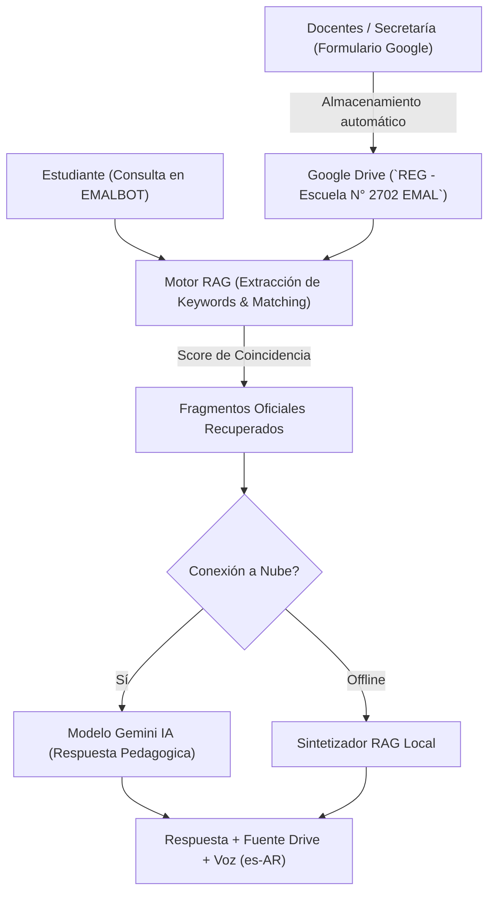

<p align="center">
  
</p>

# PROYECTO: EMALBOT — Asistente Educativo e Institucional con IA y Arquitectura RAG

> **Plataforma Institucional y Asistente Virtual Inteligente**  
> **Escuela Municipal de Alfabetización y Educación de Jóvenes y Adultos N° 2702 (EMAL)**  
> Güemes 710 · Puerto Madryn, Chubut, Argentina  
> Turno Vespertino: 19:15 a 22:15 hs

---

## 🏛️ Créditos Institucionales y Autoría

* **Institución Educativa:** Escuela N° 2702 EMAL
* **Creador, Desarrollador y Publicador:** **Prof. Roa Nicolás** (Docente a cargo de *Nuevas Tecnologías / NTICx*)
* **Gestión y Publicación Oficial:** Realizado a través de la cuenta de correo institucional `@escuela2702emal.edu.ar` (`roa@escuela2702emal.edu.ar`).
* **Área Temática:** Nuevas Tecnologías, Innovación Educativa, Inteligencia Artificial aplicada a la Educación de Adultos y Arquitectura RAG.

---

## 📋 Descripción del Sistema

**EMALBOT** es un asistente conversacional híbrido (Nube / Local) diseñado específicamente para acompañar las trayectorias escolares de estudiantes jóvenes y adultos de la Escuela N° 2702 EMAL. Resuelve consultas institucionales y ofrece acompañamiento pedagógico en dos grandes áreas:

1. **Área Institucional (Secretaría & Gestión):**
   - Requisitos y preinscripción para **Matrícula 2027**.
   - Horarios de atención presencial de Secretaría (19:15 a 22:15 hs).
   - Tramitación de legajos, certificados de alumno regular y certificados laborales.
   - Aclara que las resoluciones administrativas corresponden a la Secretaría y Dirección de la Escuela.

2. **Área Educativa (Formación Básica):**
   - Apoyo curricular en **Nuevas Tecnologías (Prof. Roa Nicolás)**, **Matemáticas (Prof. Zaneta Sebastián)**, **Lengua (Prof. Evans Erika)**, **Cs. Naturales (Prof. Mundaca Yamila)**, Cs. Sociales, EDI y Ed. Física.
   - Explicaciones pedagógicas adaptadas, modo *"Explicar más simple"*, generación de ejercicios de práctica y síntesis de voz en español (`es-AR`).

---

## 🔄 Arquitectura Técnica y Flujo RAG (Retrieval-Augmented Generation)



### Flujo Operativo en 5 Pasos:

1. **Carga Institucional en Drive:** Los docentes y la Secretaría ingresan contenidos y novedades mediante un Formulario de Google que organiza los documentos en la unidad compartida de Google Drive (`REG - Escuela N° 2702 EMAL`).
2. **Consulta del Estudiante:** El usuario realiza preguntas por texto o dictado por voz.
3. **Recuperación Inteligente (RAG):** El sistema escanea las carpetas de Drive y la base escolar, calcula puntajes de coincidencia y extrae las fuentes oficiales.
4. **Generación Adaptada:** La IA procesa los datos recuperados aplicando pautas pedagógicas específicas para la educación de adultos.
5. **Verificación y Accesibilidad:** Muestra la respuesta, cita las fuentes de Drive utilizadas, permite escuchar la lectura por altavoz y brinda opciones de ejercitación.

---

## 🛠️ Tecnologías Utilizadas

- **Frontend:** React 19, TypeScript, Tailwind CSS, Lucide React, React Markdown.
- **Backend / APIs:** Node.js, Express, Serverless Functions (Vercel API), Google Drive API, Google Gemini API (`@google/genai`).
- **Build Tooling:** Vite, Esbuild, Bun / npm.

---

## 💻 Instalación y Desarrollo Local

### Requisitos Previos
- **Node.js:** v18 o superior
- **Gestor de paquetes:** npm o bun

### Pasos:

1. **Clonar el repositorio:**
   ```bash
   git clone https://github.com/roanicolasrw-cmyk/emalbot.git
   cd emalbot
   ```

2. **Instalar dependencias:**
   ```bash
   npm install
   ```

3. **Configurar variables de entorno:**
   Copia el archivo `.env.example` como `.env` y configura tu API Key:
   ```env
   GEMINI_API_KEY=tu_api_key_de_gemini
   ```

4. **Iniciar servidor de desarrollo:**
   ```bash
   npm run dev
   ```
   La aplicación estará disponible en `http://localhost:3000`.

---

## 🚀 Despliegue en Vercel

Este proyecto está optimizado para su despliegue continuo en **Vercel**:
- **Build Command:** `npm run build`
- **Output Directory:** `dist`
- **Variables de Entorno requeridas:** `GEMINI_API_KEY`

---

## 📄 Licencia e Identidad Institucional

© **Escuela Municipal de Alfabetización y Educación de Jóvenes y Adultos N° 2702 (EMAL)**  
Desarrollado y administrado por el **Prof. Roa Nicolás** (Docente de *Nuevas Tecnologías*) vía cuenta institucional `@escuela2702emal.edu.ar`.  
*Uso educativo e institucional reservado para la comunidad de la Escuela N° 2702 EMAL.*
